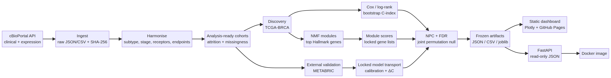

# Replica

### Which breast cancer subtypes survive external validation?

[](https://github.com/imSheheryar/replica/actions/workflows/ci.yml)
[](https://github.com/imSheheryar/replica/actions/workflows/pages.yml)
[](https://www.python.org/)
[](LICENSE)

A pre-specified, internally frozen replication audit of breast cancer subtype systems across **TCGA-BRCA** and **METABRIC**, with censoring-aware permutation tests, nonparametric combination (NPC), FDR control, external validation, expression modules, a clinical evidence dashboard, and a read-only FastAPI service.

**Live dashboard:** [imSheheryar.github.io/replica](https://imSheheryar.github.io/replica/)


*The analysis plan is version-controlled in [`docs/preregistration.md`](docs/preregistration.md) and was frozen before outcome analysis. It is an internal pre-registration, not an externally deposited registry entry; the audit log records every correction and deviation.*

---

## The finding

**TL;DR — Cohort-specific.** PAM50 separation in TCGA OS (p = 1.55e-01; BH q = 0.207) and METABRIC OS (p = 5.00e-04; BH q = 0.002). Out-of-fold ΔC over the clinical baseline was -0.013 [-0.027, -0.000] in TCGA and +0.004 [-0.002, +0.009] in METABRIC. The locked TCGA clinical + PAM50 model transported with C-index 0.640 and ΔC +0.008 over the clinical-only model. The four-component global NPC test gave p = 0.0005; this is a global association test, not a replication test, and the METABRIC components drive it.

The important result is not that PAM50 is "significant." It is whether the published categories survive an independent cohort and whether they add anything beyond age, stage, ER, and PR. Replica reports both, including the uncomfortable case where a subtype system is prognostic but not incremental.



## What this project contributes

Replica is not a new classifier and not another TCGA clustering notebook. Its contribution is an **audit design** plus an empirical answer:

- **Subtype as a transported predictor, not a label to be re-derived.** The published PAM50/Claudin-low calls are frozen, the TCGA model is locked, and the same coefficients are applied to METABRIC.
- **Censoring-aware NPC across dependent endpoints.** The global test permutes bivariate outcome pairs jointly within each cohort, so OS–DFS/RFS dependence and the censoring distribution are preserved rather than assumed away.
- **External modules without outcome leakage.** NMF is fitted in TCGA; the top-30 genes per module are locked before METABRIC is scored, so METABRIC outcomes cannot influence module definition.
- **A negative result that is interrogated, not rescued.** The primary TCGA OS test is null; the full-available-cohort sensitivity shows the null is power/selection-sensitive, but the canonical Basal-worst pattern still does not replicate.
- **Release engineering.** Frozen JSON artifacts, schema/sanity gates, 14 unit tests, Ruff, CI, Docker, a static Plotly dashboard, and a read-only FastAPI service.

## Why this is not another TCGA clustering notebook

Most subtype papers derive a classifier and report survival in the same cohort. That design cannot separate reproducible biology from overfitting, platform effects, or confounding. Replica freezes the published calls, locks the model, moves it to an independent cohort, and evaluates the transport.

| Design choice | What it prevents |
|---|---|
| Pre-specified analysis plan, frozen before outcomes | post-hoc endpoint and subgroup selection |
| TCGA reference → METABRIC external validation | same-cohort optimism |
| Clinical baseline (age, stage, ER, PR) | attributing generic prognosis to subtype |
| Out-of-fold ΔC with paired bootstrap | in-sample C-index inflation |
| Bivariate outcome permutation | invalid tests that permute only the event flag |
| Joint NPC calibration | an independence assumption across OS and DFS/RFS |
| BH/BY for module families; maxT as a methods check | cherry-picked "significant" modules |
| Locked NMF gene lists | outcome leakage into external module scores |
| Read-only API over frozen JSON | a dashboard that silently changes a p-value |

## Scorecard

The primary family is four tests: subtype log-rank in TCGA OS, subtype log-rank in METABRIC OS, and the incremental likelihood-ratio test in each OS cohort. BH is applied at q = 0.05. With 2,000 permutations, a reported p of 0.0005 is the Monte Carlo floor (1/2001), not an exact population p-value.

| Cohort | Endpoint | n | Events | C-index | Log-rank p | BH q |
|---|---|---:|---:|---:|---:|---:|
| TCGA | OS | 868 | 110 | 0.573 | 1.55e-01 | 0.207 |
| TCGA | DFS | 763 | 64 | 0.580 | 6.15e-01 | — |
| METABRIC | OS | 1,173 | 692 | 0.576 | 5.00e-04 | 0.002 |
| METABRIC | RFS | 1,172 | 496 | 0.596 | 5.00e-04 | — |

The TCGA null is a failure to meet the pre-specified replication rule in this cohort, not evidence that PAM50 carries no biological signal. The sensitivity below makes that distinction concrete.

### Sensitivity: the complete-case filter matters

The primary cohort requires age, stage, ER, and PR. This sensitivity uses every patient with a four-class subtype and a valid endpoint, without the clinical complete-case filter. It is not a rescue; it shows how much the exclusion changes the answer.

| Cohort | Endpoint | n | Events | C-index | Permutation p |
|---|---|---:|---:|---:|---:|
| TCGA | OS | 933 | 125 | 0.592 | 1.55e-02 |
| TCGA | DFS | 813 | 71 | 0.579 | 4.95e-01 |
| METABRIC | OS | 1,608 | 965 | 0.576 | 5.00e-04 |
| METABRIC | RFS | 1,605 | 665 | 0.591 | 5.00e-04 |

The primary complete-case TCGA OS analysis had 110 events and did not reach subtype significance. In the full subtype + OS cohort (933 patients, 125 events), the overall subtype term was significant (permutation p = 0.015), but the Basal hazard ratio was 1.05 [0.64, 1.73], so the canonical Basal-worst pattern still did not replicate. The negative primary result is therefore power/selection sensitive, not evidence that PAM50 carries no information.

This release reports the full-available-cohort sensitivity and the METABRIC IntClust benchmark. The remaining analyses listed in the pre-registration are prespecified extensions, not executed results; see the audit log for the exact status.

## Incremental value beyond clinical variables

Out-of-fold C-index from 5-fold cross-validation within each cohort. The same folds are used for the clinical and clinical + subtype models. ΔC is paired; the interval is a patient-level bootstrap.

| Cohort | Endpoint | Clinical C | Clinical + PAM50 C | ΔC | 95% CI | LR p |
|---|---|---:|---:|---:|---|---:|
| TCGA | OS | 0.751 | 0.738 | -0.013 | [-0.027, -0.000] | 3.53e-01 |
| TCGA | DFS | 0.654 | 0.653 | -0.001 | [-0.018, +0.016] | 7.89e-01 |
| METABRIC | OS | 0.630 | 0.634 | +0.004 | [-0.002, +0.009] | 2.51e-02 |
| METABRIC | RFS | 0.596 | 0.616 | +0.019 | [+0.001, +0.037] | 6.19e-04 |

The METABRIC OS likelihood-ratio p is 0.025, but the paired ΔC interval includes zero and the TCGA ΔC is negative. The incremental criterion therefore fails even though the LR test is nominally significant in one cohort. That distinction is the point of reporting effect size and interval alongside the p-value.

## External transport

The TCGA clinical + PAM50 model is locked and applied to METABRIC. Discrimination uses risk ranking; calibration at 60 months uses the TCGA baseline hazard and therefore exposes baseline-hazard differences rather than hiding them.

| Model | C-index | 95% CI | ΔC vs clinical |
|---|---:|---|---:|
| Clinical | 0.632 | [0.608, 0.655] | — |
| Clinical + PAM50 | 0.640 | [0.616, 0.664] | +0.008 [+0.0001, +0.0151] |

Calibration slope: **0.71**. A slope near 1 means the locked linear predictor transfers on the log-hazard scale; a slope below 1 indicates over-dispersion.

The transport ΔC is small and its interval only just excludes zero. It is evidence of a detectable rank improvement, not evidence of a clinically useful reclassification.

### Internal benchmark: IntClust

IntClust has no external cohort with comparable labels, so it is a METABRIC-only benchmark, not a replication. It asks whether a more granular integrative cluster system adds discrimination beyond PAM50 and clinical variables in the same cohort.

| Model | C-index | ΔC vs clinical + PAM50 |
|---|---:|---:|
| Clinical | 0.630 | -0.0036 |
| Clinical + PAM50 | 0.634 | — |
| Clinical + PAM50 + IntClust | 0.640 | +0.0056 |

The IntClust increment is small (+0.0056) and internally estimated. It is reported to show that the audit can benchmark a second subtype system, not as external evidence.

## Nonparametric combination

The global test combines four dependent components: TCGA OS, TCGA DFS, METABRIC OS, and METABRIC RFS. The null distribution is generated by permuting outcome pairs jointly within each cohort, preserving the OS–DFS/RFS correlation. Liptak is the primary combiner; Fisher and Tippett are implemented as alternative combiners but are not presented as executed cohort analyses.

- Global NPC p: **0.0005**
- Component p-values: 0.307, 0.495, ≤0.001, ≤0.001
- Permutations: 2,000
- Method: liptak

**Read this as a global association test, not a replication test.** The two METABRIC components are at the permutation floor (0.0005 each), while the TCGA OS and DFS components are 0.307 and 0.495. A significant global NPC therefore does not overturn the cohort-specific decision; it says the four-endpoint ensemble contains signal, concentrated in METABRIC.

Fisher and Tippett combiners and permutation maxT are implemented and unit-tested. The cohort-level result reported here is Liptak; the other combiners are not presented as executed cohort analyses.

## Expression modules

NMF is fitted in TCGA only, on a pre-specified 995-gene Hallmark marker panel. METABRIC module scores are the mean z-scored expression of the locked top-30 genes per module, so no METABRIC outcome information enters module definition.

Selected rank: **k = 3**. Module-level Cox models are adjusted for the clinical baseline; BH is applied at q = 0.10.

| Module | Cohort | HR per SD | Cox p | BH q |
|---|---|---:|---:|---:|
| M1 | TCGA | 0.82 | 8.48e-02 | 0.254 |
| M1 | METABRIC | 0.96 | 4.53e-01 | 0.536 |
| M2 | TCGA | 1.06 | 5.61e-01 | 0.561 |
| M2 | METABRIC | 1.04 | 2.55e-01 | 0.536 |
| M3 | TCGA | 0.91 | 3.42e-01 | 0.513 |
| M3 | METABRIC | 1.03 | 5.36e-01 | 0.536 |

The modules are strongly subtype-associated (Kruskal–Wallis q values below 1e-60) but none is independently prognostic after clinical adjustment (all BH q > 0.25). That is a useful negative result: the expression structure is real, but it is largely collinear with the subtype/clinical axis rather than a new independent risk factor.

## Quickstart

```bash
git clone https://github.com/imSheheryar/replica
cd replica
python3 -m venv .venv
.venv/bin/pip install -e ".[dev]"

# Rebuild the raw downloads (requires internet; cBioPortal API)
make clinical
make expression

# Harmonise, analyse, build the dashboard, and run release gates
make pipeline

# Serve the API + dashboard
make api
# http://127.0.0.1:8000
```

If the raw data are already present, `make analysis` and `make site` are enough. The pipeline is deterministic under seed `20261123`.

Run `make test`, `make lint`, and `make validate` to reproduce the release gates. The API can be served with `make api`; it reads frozen artifacts and never fits a model.

## Repository map

| Path | Purpose |
|---|---|
| `config/analysis.yaml` | frozen primary parameters, seed, permutation counts, FDR thresholds |
| `docs/preregistration.md` | hypotheses, endpoints, models, decision rules, before outcomes |
| `docs/methods.md` | derivations, permutation mechanics, NPC calibration, limitations |
| `docs/data_card.md` | cohort provenance, harmonisation, missingness, ethics |
| `docs/model_card.md` | intended use, out-of-scope use, metrics, ethical considerations |
| `docs/mlops.md` | ingest → analyse → validate → serve → release gates |
| `docs/audit_log.md` | decisions and deviations with timestamps |
| `src/replica/data.py` | clinical harmonisation, expression features, attrition |
| `src/replica/survival.py` | Cox, log-rank, censoring-aware permutations, bootstrap C-index |
| `src/replica/stats.py` | NPC, Fisher/Liptak/Tippett, BH/BY, maxT |
| `src/replica/models.py` | NMF discovery and locked module scoring |
| `scripts/fetch_clinical.py` | cBioPortal clinical download + manifests |
| `scripts/fetch_expression.py` | 995-gene expression panel download + checksums |
| `scripts/run_analysis.py` | primary audit, transport, IntClust, modules, NPC |
| `scripts/validate_artifacts.py` | release gates and statistical sanity checks |
| `scripts/build_site.py` | static Plotly dashboard |
| `app/api.py` | read-only FastAPI service |
| `tests/` | NPC, FDR, survival, harmonisation tests |
| `Dockerfile` | API + dashboard image |
| `render.yaml` | Render blueprint for the read-only API |
| `.github/workflows/` | CI and GitHub Pages deployment |

## Statistical core

The permutation test permutes the **bivariate outcome pair** \((T_i,\delta_i)\), not just the event indicator. That preserves the censoring distribution. For adjusted tests, outcomes are permuted within age × stage × ER strata. The log-rank statistic is implemented directly so the scheme is auditable and thousands of permutations are practical.

NPC calibrates the combined statistic against the **joint** permutation distribution. For every permutation, the same row permutation is applied to OS and DFS/RFS within a cohort, so the dependence between endpoints is preserved. The p-value is \((1+\#\{C_b \ge C_{\text{obs}}\})/(B+1)\), never zero.

FDR control uses Benjamini–Hochberg for the primary family and module family, Benjamini–Yekutieli as a dependence-robust sensitivity analysis, and permutation maxT for the module family.

## Dashboard and API

The static dashboard is built from frozen artifacts with Plotly and deployed to GitHub Pages. It shows the primary scorecard first, then incremental value, hazard ratios, Kaplan–Meier curves, transport calibration, the NPC null distribution, and expression modules. Exploratory and sensitivity results are visually separated and labelled.

The FastAPI service exposes only aggregate JSON: `/health`, `/api/summary`, `/api/scorecard`, `/api/forest`, `/api/km`, `/api/modules`, `/api/npc`, `/api/transport`, `/api/methods`. It never accepts patient data and never fits a model.

**Deploy.** The dashboard deploys through `.github/workflows/pages.yml`. The API is container-ready: `docker build -t replica:1.0.0 . && docker run -p 8000:8000 replica:1.0.0`. A Render blueprint is included in `render.yaml`; it points at the same Dockerfile and health endpoint. The public dashboard is static; the API is optional and read-only.

## Limitations

The subtype labels are not assay-identical across cohorts. TCGA PAM50 calls and METABRIC PAM50/Claudin-low calls were produced by different pipelines. TCGA grade is absent from the cBioPortal export, so the primary clinical baseline uses age, stage, ER, and PR; grade is a METABRIC-only sensitivity. DFS and RFS are different endpoints. Complete-case analysis can bias estimates if missingness is informative. The audit is observational and cannot identify a causal effect of subtype on survival. The permutation test addresses exchangeability, not confounding. The pre-registration is internal rather than externally registered, and the 2,000-permutation budget limits resolution at the tail; both are stated rather than hidden.

## Citation

```bibtex
@software{replica2026,
  author = {imSheheryar},
  title = {Replica: A replication audit of breast cancer subtype systems},
  year = {2026},
  url = {https://github.com/imSheheryar/replica}
}
```

Source cohorts: TCGA Research Network; Curtis et al., *Nature* 2012; Pereira et al., *Nature Communications* 2016. Code MIT; data remain governed by the source terms.
