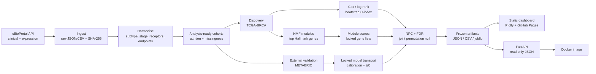

# Architecture

Replica is a deterministic batch pipeline with a read-only serving layer. The statistical artifacts are frozen before the dashboard or API reads them.

## Design principles

The pipeline separates **estimation** from **presentation**. `scripts/run_analysis.py` writes `artifacts/results.json` and the tables; `scripts/build_site.py` and `app/api.py` only read those files. A dashboard cannot silently change a p-value.

The configuration is frozen in `config/analysis.yaml`. Primary parameters (seed, permutation counts, FDR thresholds, NMF ranks) are not CLI flags. Changing one requires a new config version and an audit-log entry.

Raw data are never committed. The download scripts write checksums and manifests, and the analysis reads only the harmonised cohort files. This keeps the repository small and makes the data provenance auditable.

The permutation engine is the computational core. It is implemented directly rather than delegated to a black-box test so that the censoring-aware scheme, the joint endpoint permutation, and the NPC calibration are visible in code and testable in isolation.
